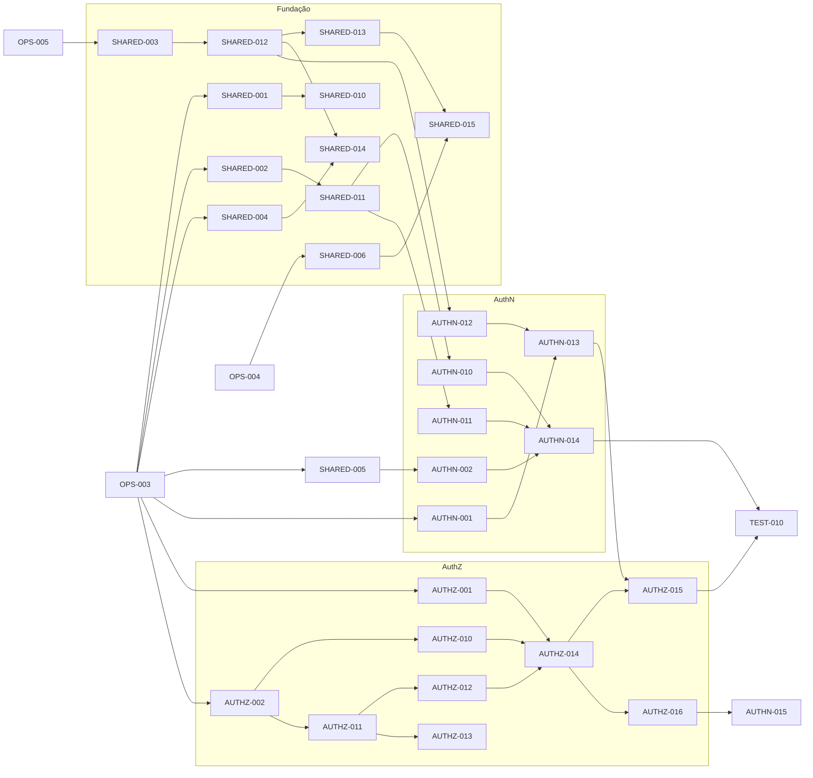

# Roadmap

Fonte da verdade do planejamento. Design: [spec](superpowers/specs/2026-11-06-iam-design.md).
Cada item é marcado como concluído **no mesmo PR que o conclui**.

Legenda: ⏳ pendente · 🚧 em andamento · ✅ concluído · 📜 contrato (libera frentes em paralelo)

Prefixos: `OPS` pipeline e infraestrutura · `SHARED` serviços compartilhados ·
`AUTHN` · `AUTHZ` · `TEST` clientes de teste e suítes ponta a ponta.

## Marco 0: fábrica

**Objetivo:** tornar a verificação automatizada confiável antes do código de produto
([ADR 0004](adr/0004-milestones-0-and-1.md)).
**Concluído quando:** todos os checks de PR da seção 11 do spec rodam e são obrigatórios
no ruleset; o servidor vazio sobe localmente e no CI; o harness e2e roda o cliente A
contra ele; os arquivos de comunidade e de CRA existem.

| ID | Item | Status | Depende de |
|---|---|---|---|
| OPS-001 | Estrutura de módulos, `go.work`, `cmd/iam` com health check | ✅ | — |
| OPS-002 | `golangci-lint` com regras de fronteira (`depguard`, `forbidigo`) e um teste que prova que uma violação falha | ✅ | OPS-001 |
| OPS-003 | CI geral: formatação, lint, `go vet`, testes com `-race`, `govulncheck`, `gosec`, `gitleaks`, licenças, `actionlint` | ✅ | OPS-002 |
| OPS-004 | `buf`: lint, breaking, geração verificada, Protobuf mínimo | ✅ | OPS-001 |
| OPS-005 | Postgres real no CI e harness de testes de integração | ✅ | OPS-001 |
| OPS-006 | Ambiente local com um comando (Postgres + servidor) | ✅ | OPS-001 |
| OPS-007 | Imagem com `ko`, base fixada por digest, varredura e SBOM (CycloneDX) | ✅ | OPS-003 |
| OPS-008 | `LICENSE` (Apache-2.0), `SECURITY.md`, `CONTRIBUTING.md`, política de suporte | ✅ | — |
| OPS-009 | Harness e2e com esqueleto do cliente de teste A | ✅ | OPS-005, OPS-006 |
| OPS-010 | Checks obrigatórios no ruleset, `CODEOWNERS` das áreas sensíveis, auto-merge fora delas | ✅ | OPS-003 |
| OPS-011 | Workflows noturnos: fuzzing longo e benchmarks com detecção de regressão | ✅ | OPS-003 |

## Marco 1: AuthN e AuthZ mínimos, ponta a ponta

**Concluído quando:** no laboratório, o cliente A faz login OIDC com senha e com passkey
numa organização de um tenant, recebe tokens e consulta uma permissão RBAC pelo AuthZEN; a
plataforma usa esse RBAC nos papéis administrativos; os testes de abuso da seção 11 do spec
passam; as metas do [ADR 0011](adr/0011-latency-and-scale-targets.md) são medidas.

O marco 1 é executado em quatro planos: **1A** contratos e fundação
(`docs/superpowers/plans/2026-11-07-milestone-1a-contracts-foundation.md`), **1B** AuthZ,
**1C** AuthN e **1D** integração e deploy no laboratório.

### Contratos (primeiro)

| ID | Contrato | Status | Depende de |
|---|---|---|---|
| SHARED-001 📜 | C1 esquema de configuração (tipos, validação, documentação gerada) | ✅ | OPS-003 |
| SHARED-002 📜 | C2 porta de criptografia | ✅ | OPS-003 |
| SHARED-003 📜 | C3 portas de armazenamento + suíte de contrato (inclui abuso entre tenants) | ⏳ | OPS-005 |
| SHARED-004 📜 | C4 esquema do evento de auditoria | ⏳ | OPS-003 |
| SHARED-005 📜 | C5 biblioteca de máquinas de estados (módulo publicável) | ⏳ | OPS-003 |
| SHARED-006 📜 | C6 API administrativa em Protobuf (tenants, organizações, aplicações, usuários) | ⏳ | OPS-004 |
| AUTHN-001 📜 | C8 perfil OIDC suportado e discovery | ⏳ | OPS-003 |
| AUTHN-002 📜 | C9 API de login guiada (estado e passos) | ⏳ | SHARED-005 |
| AUTHZ-001 📜 | C7 AuthZEN: avaliação individual e em lote | ⏳ | OPS-003 |
| AUTHZ-002 📜 | C10 linguagem de políticas (núcleo Cedar), modelo de relações e corpus de testes | ⏳ | OPS-003 |

### Implementação

| ID | Item | Status | Depende de |
|---|---|---|---|
| SHARED-010 | Configuração: carga, precedência, alertas e proibições absolutas | ✅ | SHARED-001 |
| SHARED-011 | Criptografia: Argon2id, JOSE (`go-jose`), aleatoriedade, adaptador de chaves | ✅ | SHARED-002 |
| SHARED-012 | Adaptador Postgres, migrações, RLS, orçamento de conexões com teste | ⏳ | SHARED-003 |
| SHARED-013 | Tenancy: tenant, organização, membership, aplicação, tenant de sistema | ⏳ | SHARED-003, SHARED-012 |
| SHARED-014 | Auditoria encadeada por hash | ⏳ | SHARED-004, SHARED-012 |
| SHARED-015 | API administrativa servida com Connect | ⏳ | SHARED-006, SHARED-013 |
| AUTHN-010 | Autenticador por senha (NIST SP 800-63-4, senha vazada) | ⏳ | SHARED-011, SHARED-013 |
| AUTHN-011 | Autenticador por passkey (`go-webauthn`), recusado fora do tenant | ⏳ | SHARED-011, SHARED-013 |
| AUTHN-012 | Sessão com fatores carimbados | ⏳ | SHARED-005, SHARED-012 |
| AUTHN-013 | Provedor OIDC: authorize + PKCE, token, refresh com rotação, JWKS, userinfo | ⏳ | AUTHN-001, AUTHN-012, SHARED-011 |
| AUTHN-014 | API de login guiada e `login-ui` mínima | ⏳ | AUTHN-002, AUTHN-010, AUTHN-011, AUTHN-012 |
| AUTHN-015 | Inicialização do master e conta de operador | ⏳ | AUTHN-014, AUTHZ-016 |
| AUTHZ-010 | Armazém de relações | ⏳ | AUTHZ-002, SHARED-012 |
| AUTHZ-011 | Parser e validador de políticas (texto e JSON, mesma validação), fuzzing | ⏳ | AUTHZ-002 |
| AUTHZ-012 | Avaliador e explicação; testes diferenciais contra `cedar-go`; fail-closed | ⏳ | AUTHZ-011 |
| AUTHZ-013 | Versões de política com validação e ativação | ⏳ | AUTHZ-011, SHARED-012 |
| AUTHZ-014 | PDP AuthZEN (individual e em lote) com auditoria de decisões | ⏳ | AUTHZ-001, AUTHZ-010, AUTHZ-012, SHARED-014 |
| AUTHZ-015 | SDK Go com cache de decisões e validação de token | ⏳ | AUTHZ-014, AUTHN-013 |
| AUTHZ-016 | Papéis administrativos da plataforma sobre o AuthZ | ⏳ | AUTHZ-014, SHARED-015 |
| TEST-010 | Cliente A completo: login, tokens, decisão | ⏳ | OPS-009, AUTHN-014, AUTHZ-015 |
| TEST-011 | Suíte de abuso do marco 1 (seção 11 do spec) | ⏳ | AUTHN-013, AUTHZ-014 |
| OPS-101 | Deploy no laboratório: serviço e job de migração no Cloud Run, leitura do `activationPolicy` | ⏳ | OPS-007, SHARED-012 |
| OPS-102 | Benchmarks das metas do ADR 0011 | ⏳ | AUTHN-013, AUTHZ-014 |

### Frentes paralelas

Depois dos contratos, três frentes andam em paralelo; os núcleos de domínio, sessões,
tokens e criptografia não são divididos entre agentes (brief 4.25).

### Pendências herdadas do marco 0

Levantadas nas revisões do marco 0; entram nos itens indicados.

| Pendência | Onde entra |
|---|---|
| `/readyz` sem cache pode ocupar as 2 conexões do pool; ping no boot é fatal com a instância dormindo | OPS-101 |
| `depguard`: negar `net/rpc`, `net/smtp`, `net/url` e afins nos núcleos; liberar imports só de teste (`cedar-go`) na allow-list estrita | AUTHZ-012, primeiro código de núcleo |
| Pânico dentro de uma checagem de prontidão derruba o processo | OPS-101 |
| Teste de que URL inválida não vaza credencial | SHARED-012 |
| Reprodutibilidade provada no build do `ko` (com ldflags), não só no `go build` | antes do primeiro release |
| Advisories nas ferramentas de `tools/*` sem relatório (só o módulo distribuído é barrado) | OPS-011, relatório noturno não bloqueante |
| `make dev` exercitado de ponta a ponta no CI (job `Dev env`); torná-lo check obrigatório | ruleset, junto com a próxima mudança de checks |
| Dono decidir: ampliar `.github/sensitive-paths.txt` (`.ko.yaml`, `go.work`, `buf.*`, `api/**`, `go.mod`/`go.sum`) e mover o guarda para `pull_request_target` | decisão do dono, sem item no roadmap |

## Camadas seguintes (ordem proposta, detalhadas quando o marco anterior fechar)

| Marco | Objetivo | Principais itens |
|---|---|---|
| 2 | AuthZ completo em dados e desempenho; MFA | Outbox no SDK e tokens de consistência; plano de filtro e listagem paginada; avaliação local no SDK Go; TOTP e códigos de recuperação; adaptador SMTP e e-mail de verificação |
| 3 | Federação e administração | Login social e SSO OIDC (Google, Microsoft); SAML; console mínimo do operador e do tenant; promoção de organização a tenant |
| 4 | Acesso dinâmico e estados | Relações com validade, solicitações, JIT, delegação, obrigações; estados e transições declarativos |
| 5 | Aprovação M de N | Quórum com assinatura WebAuthn, pacote de evidências, emergência, operador único |
| Posteriores | Destino do brief, seção 5 | SCIM, LDAP, ICP-Brasil, device flow, CIBA, DPoP, PAR, FAPI; agentes e MCP; SDKs de outras linguagens e avaliação local via WebAssembly; provedor Terraform; site; perfis de conformidade; verificação de idade |
